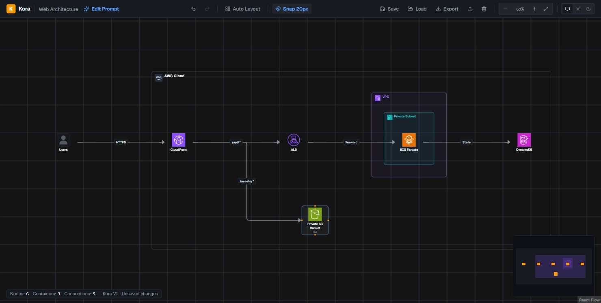
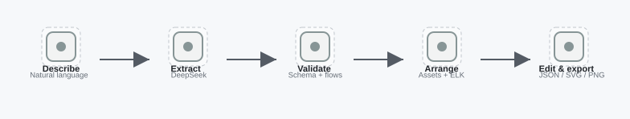

<h1 align="center">Kora</h1>

<p align="center"><a href="README.md">English</a> · Tiếng Việt</p>

<p align="center">Mô tả kiến trúc AWS. Nhận sơ đồ. Chỉnh theo cách của bạn.</p>

<p align="center">
  <a href="https://kora-nine-kappa.vercel.app/">Mở editor</a> ·
  <a href="docs/architecture.md">Kiến trúc</a> ·
  <a href="docs/run-local.md">Chạy local</a> ·
  <a href="docs/README.md">Tài liệu</a>
</p>

<p align="center">
  
  
  
</p>

Kora chuyển mô tả bằng ngôn ngữ tự nhiên thành sơ đồ kiến trúc AWS có thể chỉnh
sửa. Mô hình kiến trúc được tách khỏi bố cục; Kora kiểm tra cấu trúc và các yêu
cầu đã trích xuất, sau đó sắp xếp icon AWS trong các lớp cloud, VPC và subnet.



Ảnh là một sơ đồ mẫu trong editor. **Bản online hiện hỗ trợ chỉnh sửa, sơ đồ mẫu,
import và export; tính năng gọi AI đang khóa trên production.** Có thể dùng
DeepSeek ở môi trường local với API key riêng. Tên miền `kora.aurel.id.vn` đang
được kết nối; link editor phía trên dùng địa chỉ Vercel hiện có.

## Chức năng

| Từ mô tả đến sơ đồ | Canvas chỉnh sửa | Xuất kết quả |
|---|---|---|
| Trích xuất thành phần, phạm vi và luồng kết nối, rồi kiểm tra và sắp xếp kiến trúc. | Kéo icon hoặc nhóm, đổi nhãn, nối dịch vụ, hoàn tác và chạy lại Auto Layout. | Lưu trên trình duyệt, sao lưu JSON để chỉnh tiếp, hoặc xuất SVG và PNG. |

- Icon dịch vụ AWS và thành phần generic cho hệ thống bên ngoài.
- Bố cục phân cấp và đường nối vuông góc bằng ELK.
- Kiểm tra dữ liệu và ý nghĩa riêng, có giới hạn số lần AI sửa kết quả.
- Giữ chuột phải để di chuyển canvas; kéo chuột trái trong minimap để điều hướng.
- Căn lưới, thu phóng và giao diện sáng, tối hoặc theo hệ thống.

## Cách hoạt động

<picture>
  <source media="(prefers-color-scheme: dark)" srcset="docs/images/kora-workflow-dark.svg" />
  <source media="(prefers-color-scheme: light)" srcset="docs/images/kora-workflow-light.svg" />
  
</picture>

Hình được tạo bằng bộ layout và xuất SVG của Kora. Có thể tải
[JSON chỉnh sửa được](docs/images/kora-workflow.json) rồi dùng nút Import trong editor.

AI tạo mô hình kiến trúc; Kora tính vị trí, kích thước và đường nối. Thao tác sửa
đi qua lịch sử lệnh nên một lần kéo, đổi tên hoặc sắp xếp lại có thể hoàn tác
bằng một thao tác. Sơ đồ được lưu trong trình duyệt, chưa có cơ sở dữ liệu lưu
sơ đồ trên server.

Kiểm tra ý nghĩa đối chiếu sơ đồ với yêu cầu trích xuất từ prompt, giúp phát
hiện thành phần thiếu và luồng sai. Kết quả vẫn cần được đối chiếu với hệ thống
thực tế. Xem [tài liệu kiến trúc](docs/architecture.md) để biết các lớp dữ liệu
và giới hạn hiện tại.

## Chạy local

Cần Node.js 24 và npm.

```bash
git clone https://github.com/9ducanh9/kora.git
cd kora
npm ci
cp .env.example .env.local
npm run dev
```

Mở `http://localhost:3000`. Trong **Edit Prompt**, chọn **Quick Test** và
**Acceptance Test (Sec 22)**, rồi bấm tạo sơ đồ mẫu không cần key.
Muốn gọi AI ở local, điền `DEEPSEEK_KEY` vào `.env.local` hoặc
nhập key trong phần cài đặt của prompt.

Với PowerShell có thể dùng `Copy-Item .env.example .env.local`. Xem
[hướng dẫn local](docs/run-local.md) để biết thao tác và cách kiểm tra.

Icon AWS giữ nguyên quyền sở hữu tương ứng; font đi kèm có giấy phép trong
[public/fonts](public/fonts). Kora là dự án độc lập, không phải sản phẩm của AWS.
